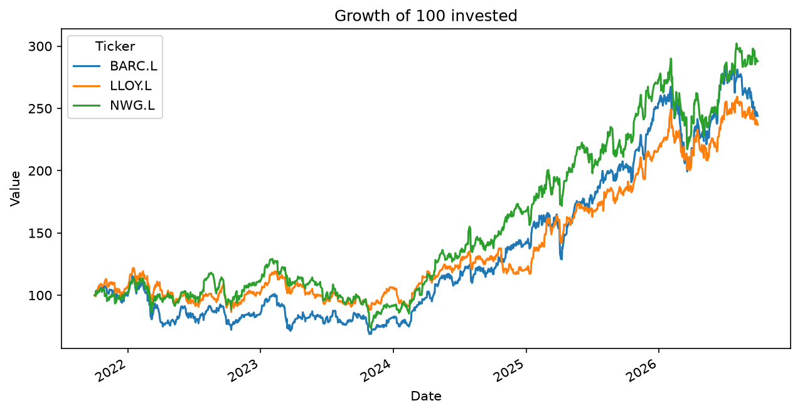

# UK Banks: Risk and Return Comparison

**Question:** Which of Lloyds, Barclays and NatWest delivered the best return relative to risk between 1st Oct 2021 and 1st Oct 2026?

**Method:** Downloaded daily adjusted closing prices using yfinance, calculated daily returns in pandas, and computed total return, annualised return, annualised volatility, return per unit of risk, maximum drawdown and pairwise correlations. Also tested an equal-weight portfolio of all three banks.

## Results

| | NatWest | Barclays | Lloyds |
|---|---|---|---|
| Total return | 187.8% | 144.0% | 136.9% |
| Annualised return | 23.6% | 19.5% | 18.8% |
| Annualised volatility | 29.9% | 31.3% | 27.1% |
| Return per unit of risk | 0.79 | 0.63 | 0.69 |
| Max drawdown | -43.1% | -40.4% | -29.1% |

**Correlation matrix (daily returns)**

| | BARC.L | LLOY.L | NWG.L |
|---|---|---|---|
| BARC.L | 1.00 | 0.75 | 0.73 |
| LLOY.L | 0.75 | 1.00 | 0.76 |
| NWG.L | 0.73 | 0.76 | 1.00 |

**Equal-weight portfolio of all three:** 21.5% annualised return, 26.8% annualised volatility, 0.80 return per unit of risk.

## Conclusion

NatWest returned 187.8% in total (23.6% annualised), compared with 144.0% (19.5%) for Barclays and 136.9% (18.8%) for Lloyds. Volatility was 29.9% for NatWest, 31.3% for Barclays and 27.1% for Lloyds, giving NatWest the best return per unit of risk at 0.79, against 0.69 for Lloyds and 0.63 for Barclays. NatWest's higher return came with the deepest peak-to-trough fall (-43.1%), compared with -40.4% for Barclays and -29.1% for Lloyds, so Lloyds was the most resilient in its worst period. Pairwise correlations were between 0.73 and 0.76, so the banks moved closely together, and the equal-weight portfolio gave only a small reduction in risk compared with holding Lloyds alone.

## Limitations

- Three UK banks over a single five-year window
- I did not test whether the differences are statistically meaningful, or investigate what caused them
- Past performance does not predict future returns
- Return per unit of risk is a simple ratio (annualised return divided by annualised volatility), not a full Sharpe ratio, as it does not subtract a risk-free rate
- This is a data exercise and not investment advice

## Tools

Python, pandas, matplotlib, yfinance
